# FTrap – FRITZ!Box DNS filter dashboard

Pi-hole-style statistics dashboard for the built-in DNS filter of FRITZ!OS 8.4x/8.50.

FTrap polls the DNS filter status of a FRITZ!Box with read-only requests, stores the counters in SQLite and shows them as a small static web dashboard. Honest limitation: the box only provides overall counters (blocked / total) and filter list metadata – no per-domain or per-device data, so there are no "top domains" lists.

> [!WARNING]
> **Beta API.** The DNS filter is available from FRITZ!OS 8.50 (final since 29 Sep 2026, initially for the 7690/5690/5630, more models to follow) and in lab releases of 8.4x. This project was developed and tested with **FRITZ!OS 8.40 Labor, build 136730**. Third-party projects report the same path (`/api/v0/beta/dnsfilter`) on 8.50 as well; that was not tested here. The API stays undocumented beta and may change or disappear with any firmware update. Treat this project as experimental and use it with caution.

**🔴 [Live demo dashboard](https://zorroficator.github.io/fritzbox-dns-filter-dashboard/)** – static page with synthetic data, no backend required.

Looking for per-query logs or filter management inside Home Assistant? See [FritzHole](https://github.com/Milinator/fritzhole-ha).

Full documentation is in the language-specific READMEs below.

🇩🇪 [Deutsch](README_DE.md) &nbsp;|&nbsp; 🇬🇧 [English](README_EN.md)
